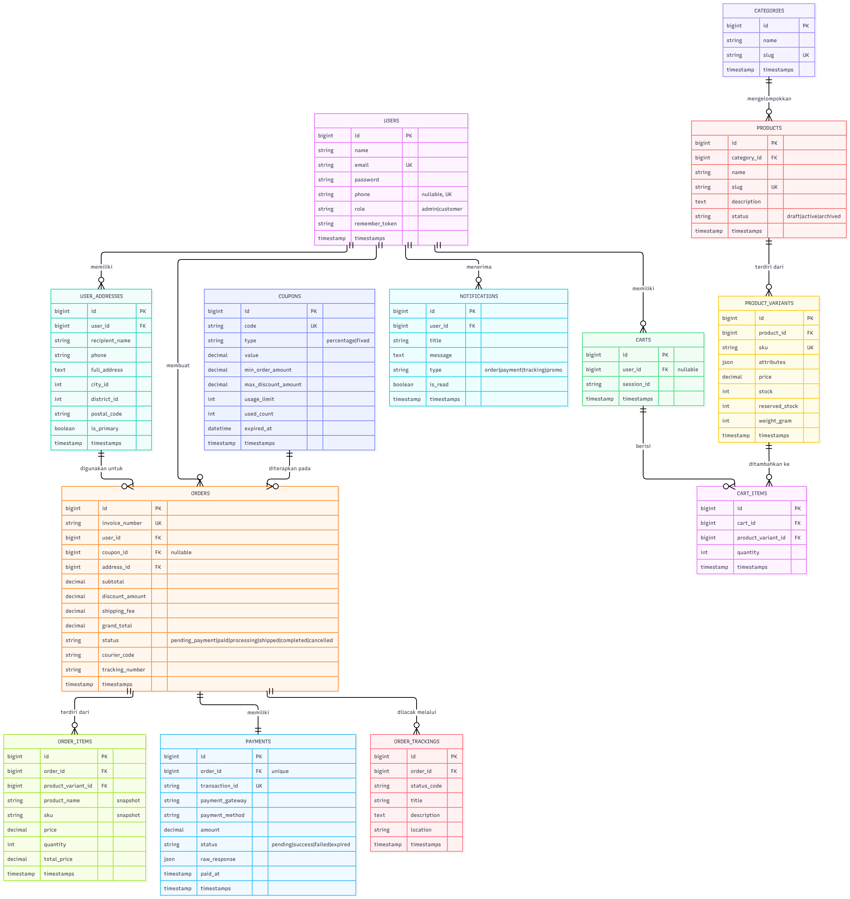
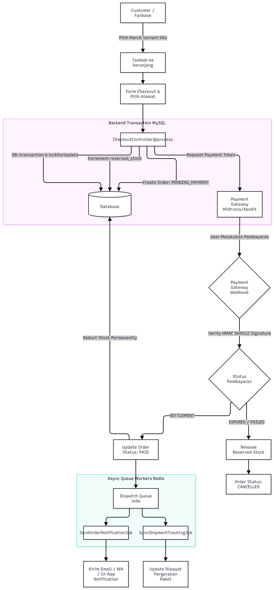

# 🛍️ Goddess Club Store

[](https://github.com/Psr354/Goddes-club-store/actions/workflows/tests.yml)
[](LICENSE)
[](https://github.com)
[](https://www.docker.com)

---

## 📖 Deskripsi Singkat

**Goddess Club Store** adalah toko merch e-commerce resmi komunitas Goddess Club yang menjual produk berlimittahunan: apparel, musik & vinyl, serta aksesoris. Aplikasi ini dibangun dengan **Laravel 13 + Docker** menyediakan pengalaman pembelian yang modern, gelap (dark theme), dan responsif, sejalan dengan desain Figma yang telah ditetapkan.

Proyek ini menyediakan solusi toko merch lengkap dengan katalog produk, keranjang belanja, pemilihan varian ukuran, kalkulasi pengiriman, integrasi checkout Midtrans Snap (disertai fallback simulasi untuk pengujian lokal), dan pelacakan pesanan real-time.

---

## ✨ Fitur Utama

- 🌙 **Dark Theme** — Tampilan hitam/cream yang nyaman mata, sesuai desain Figma
- 📦 **Database-Backed Products** — 4 produk (Apparel, Music, Accessories) dari MySQL
- 🗂️ **Kategori Filter** — Filter produk berdasarkan Apparel, Music & vinyl, Accessories
- 👕 **Pemilihan Ukuran** — Tombol S, M, L, XL, XXL dengan state `.selected`
- 📏 **Size Guide Modal** — Tabel lengkap ukuran S–XXL (chest, length, shoulder)
- 🖼️ **Produk Detail** — Panel full-screen dengan gambar gallery, thumbnails, dan info produk
- 🛒 **Cart Drawer** — Keranjang slide-out dengan promo code (CLUB10), subtotal, dan kupon diskon
- 💳 **Checkout Modal** — Form email, alamat, pemilihan kurir, dan pembayaran Midtrans Snap
- 📍 **Order Tracking** — Halaman publik pelacakan status pesanan dan nomor resi via invoice acak yang aman dari enumerasi
- 📱 **Responsive Design** — Mobile-first, breakpoint di 760px, navigasi drawer di mobile
- ⚡ **Interaksi JavaScript** — Quick add, size selection, quantity control, dismiss modal via Escape key
- 🎨 **UX Polish** — Hover effect, focus-visible, reduced-motion support, smooth scroll

---

## 🛠️ Tech Stack

| Kategori | Teknologi |
|----------|-----------|
| **Framework** | Laravel 13.37 |
| **Backend** | PHP 8.4 CLI |
| **Database** | MySQL 8.4 |
| **Cache/Queue** | Redis 7 Alpine |
| **Mail** | Mailpit (development) |
| **Container** | Docker + Docker Compose |
| **Frontend** | Blade HTML, Plain JavaScript, Layered CSS |
| **Fonts** | Google Fonts: DM Sans, Playfair Display |
| **Theme** | Dark mode (#11100f / #f4eee2 / #e62927) |

---

## 📐 Arsitektur & Diagram Sistem

### Entity Relationship Diagram (ERD)
Diagram relasi basis data yang mencakup entitas Users, Products, Variants, Carts, Orders, Payments, dan Trackings:

<p align="center">
  
</p>

### Alur Sistem (Flowchart)
Diagram alur proses belanja mulai dari penjelajahan katalog, pemilihan varian produk, keranjang belanja, hingga checkout dan webhook status pembayaran:

<p align="center">
  
</p>

---

## 📋 Prasyarat (Prerequisites)

Sebelum menjalankan proyek, pastikan telah terinstall:

- [Docker](https://www.docker.com/get-started) (versi terbaru)
- [Docker Compose](https://docs.docker.com/compose/install/)
- [Git](https://git-scm.com/downloads)

---

## 🚀 Instalasi & Setup

Ikuti langkah-langkah berikut untuk menjalankan proyek di lokal menggunakan Docker:

```bash
# 1. Clone repository
git clone https://github.com/Psr354/Goddes-club-store.git
cd Goddes-club-store

# 2. Salin file environment
cp .env.example .env

# 3. Jalankan seluruh layanan dengan Docker Compose
docker compose up -d --build

# 4. Generate Application Key di dalam kontainer
docker compose exec app php artisan key:generate

# 5. Jalankan migrasi basis data dan seeder data awal
docker compose exec app php artisan migrate:refresh --seed
```

Layanan siap digunakan dan dapat langsung diakses melalui peramban:
* **Toko Goddess Club Store:** **http://localhost:8000**
* **Mailpit (In-box Pengujian Email):** **http://localhost:8025**

> 📝 **Catatan:** Server web Laravel otomatis dijalankan oleh kontainer pada port 8000. Tidak perlu menjalankan perintah `php artisan serve` secara manual di terminal.

---

## 📖 Cara Penggunaan

### Halaman Utama

- Browse produk melalui kategori **Apparel**, **Music & vinyl**, atau **Accessories** di navbar
- Klik produk untuk melihat detail di panel full-screen
- Pilih ukuran dengan menekan tombol size (S/M/L/XL/XXL), tombol akan berwarna aktif
- Klik **Quick Add** untuk menambah ke keranjang (dengan ukuran yang dipilih)
- Buka keranjang dengan tombol **Bag** di header

### Size Guide

- Di halaman detail produk, klik tombol **Size guide ↗**
- Modal akan muncul dengan tabel ukuran lengkap (S–XXL)
- Tutup modal dengan menekan tombol **×** atau tombol **Escape**

### Checkout & Pembayaran

- Masuk ke keranjang, klik **Proceed to checkout**
- Isi formulir alamat pengiriman dan pilih kurir
- Klik **Place order** untuk membuka popup pembayaran Midtrans Snap (atau fallback simulasi saat API key belum disetel)

### Pelacakan Pesanan (Order Tracking)

- Akses menu **Track order** di navigasi atau via URL `/track`
- Masukkan nomor faktur pesanan (contoh: `GCS-XXXXXXXX`) untuk memantau linimasa status pesanan dan nomor resi pengiriman real-time

---

## 📁 Struktur Folder (Opsional)

```
goddess-club-store/
├── app/                  # Laravel App Models & Http
├── bootstrap/            # Application bootstrap files
├── config/               # Konfigurasi Laravel
├── database/             # Migrasi & Seeder
├── docs/                 # Dokumentasi diagram, arsitektur, dan desain
│   ├── architecture/     # Dokumen spesifikasi arsitektur
│   ├── design/           # Berkas desain aset
│   └── diagrams/         # Flowchart dan ERD (PNG)
├── public/               # Asset publik (CSS, JS, images)
│   ├── goddess.css       # Stylesheet utama toko
│   ├── goddess.js        # Script interaktivitas & API client
│   └── images/           # Asset media produk
├── routes/               # web.php & console.php (routing)
├── resources/views/      # Blade templates
├── docker-compose.yml    # Layanan Docker
├── Dockerfile            # Konfigurasi PHP container
└── README.md             # Dokumentasi ini
```

---

## 🔐 Akun Demo & Autentikasi Role

Aplikasi menerapkan sistem **"Satu Login, Dua Dashboard"** dengan verifikasi role aman di server Laravel:

| Role | Akun Demo | Password | Redirect Dashboard |
| :--- | :--- | :--- | :--- |
| **Customer** | `demo@example.com` | `Goddess123` | `/account` (User Dashboard, Orders, Wishlist, Address) |
| **Admin** | `admin@example.com` | `Admin123` | `/admin` (Backstage Admin, Revenue KPI, Stock Alert) |

*Tersedia tombol 1-Click Auto-Fill pada halaman login untuk pengujian cepat.*

---

## 🧪 Menjalankan Automated Tests

Seluruh pengujian unit dan fitur telah lulus (26 tests):

```bash
docker compose exec app php artisan test
```

---

## 💳 Konfigurasi Midtrans Sandbox & Keamanan Webhook

Aplikasi telah terintegrasi dengan **Midtrans Snap**:
1. Buat akun di [Midtrans Sandbox](https://dashboard.sandbox.midtrans.com/).
2. Buka menu **Settings > Access Keys**, lalu salin:
   - `Client Key` ke `MIDTRANS_CLIENT_KEY` di file `.env`
   - `Server Key` ke `MIDTRANS_SERVER_KEY` di file `.env`
3. Pastikan `MIDTRANS_IS_PRODUCTION=false` untuk lingkungan sandbox.
4. **Keamanan Webhook:**
   - Webhook resmi Midtrans diproses melalui `POST /api/payment/webhook`.
   - Ketika `MIDTRANS_SERVER_KEY` disetel atau pada lingkungan produksi, sistem mewajibkan verifikasi tanda tangan HMAC SHA-512 (`signature_key`). Permintaan tanpa tanda tangan valid otomatis ditolak (HTTP 403).
   - Untuk pengujian di lingkungan lokal/testing, disediakan endpoint simulasi `POST /api/payment/simulate`. Endpoint ini dinonaktifkan secara otomatis pada lingkungan produksi (`production`).

---

## 🤝 Cara Berkontribusi

1. **Fork** repository ini
2. Buat **branch** baru (`git checkout -b fitur-baru`)
3. **Commit** perubahan (`git commit -m "Menambah fitur X"`)
4. **Push** ke branch (`git push origin fitur-baru`)
5. Buat **Pull Request** ke branch `main`

> ⚠️ Pastikan kode Anda sesuai standar PSR-12 / Laravel Pint, menambahkan test case jika relevan, dan memperbarui dokumentasi jika ada perubahan fitur.

---

## 📜 Lisensi & Kontak

| Informasi | Detail |
|-----------|--------|
| **Lisensi** | MIT |
| **Maintainer** | [Psr354](https://github.com/Psr354) |
| **Email** | contact@goddessclubstore.id |
| **GitHub** | [@Psr354](https://github.com/Psr354) |

---

*⚡ Dibuat dengan ❤️ untuk Goddess Club — "THE MUSIC STAYS. SO DO WE."*

For a host-only preview, `php artisan serve` is also supported after `composer install`.
